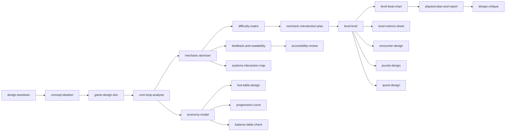

# Game Design Skills

Agent skills for a game designer and level designer AI companion.

## Scope

- **Design only.** Skills help reason about, document, and critique game and level design. They do not cover engine implementation, code, or asset production.
- Covers general game design and level design, including Rational Game Design and Rational Level Design.
- Skills keep claims of different kinds apart: a rule trace or calculation, an available cue, a player's interpretation, and a reported experience are checked in different ways. See [design critique](skills/design-critique/SKILL.md) and [source boundaries](skills/design-critique/sources.md).

## Skills

Every skill has a worked example. Examples are synthetic and labelled as such.

**Concept and structure**

| Skill | Use it to |
|---|---|
| [concept-ideation](skills/concept-ideation/SKILL.md) | generate varied concepts from a brief, then narrow by riskiest assumption and cheapest test |
| [core-loop-analysis](skills/core-loop-analysis/SKILL.md) | map loops by timescale and one-time arcs; find broken or disconnected loops |
| [design-teardown](skills/design-teardown/SKILL.md) | analyse a reference game and extract principles with their supporting conditions |
| [game-design-doc](skills/game-design-doc/SKILL.md) | write one-pagers, feature specs, and system specs anchored on pillars |

**Mechanics and Rational Game Design** (one example mechanic, the sprout seed, runs through these)

| Skill | Use it to |
|---|---|
| [mechanic-atomizer](skills/mechanic-atomizer/SKILL.md) | split a mechanic into atoms, skill loops, and tunable parameters |
| [difficulty-matrix](skills/difficulty-matrix/SKILL.md) | turn parameters into provisional difficulty bands and interactions |
| [mechanic-introduction-plan](skills/mechanic-introduction-plan/SKILL.md) | sequence teaching, practice, challenge, and combination |
| [feedback-and-readability](skills/feedback-and-readability/SKILL.md) | specify signs and feedback across channels, with priority and timing |
| [systems-interaction-map](skills/systems-interaction-map/SKILL.md) | map systemic interactions, trace chains and loops, protect forbidden outcomes |

**Numbers: balance, economy, progression, chance**

| Skill | Use it to |
|---|---|
| [balance-table-check](skills/balance-table-check/SKILL.md) | find dominated options and cost-curve outliers (with a [helper](skills/balance-table-check/balance_check.py)) |
| [economy-model](skills/economy-model/SKILL.md) | model sources, sinks, converters, and time-to-earn |
| [progression-curve](skills/progression-curve/SKILL.md) | design XP and power curves against time targets |
| [loot-table-design](skills/loot-table-design/SKILL.md) | compute drop and collection waits, pity, and disclosure (with a [helper](skills/loot-table-design/reward_math.py)) |

**Levels, encounters, puzzles, quests**

| Skill | Use it to |
|---|---|
| [level-brief](skills/level-brief/SKILL.md) | set a level's goals, mechanics, constraints, and success criteria |
| [level-beat-chart](skills/level-beat-chart/SKILL.md) | chart pacing and demands for linear and nonlinear routes |
| [level-metrics-sheet](skills/level-metrics-sheet/SKILL.md) | model routes, traversal, and sightlines; audit a layout ([spatial lessons](skills/level-metrics-sheet/spatial-reasoning.md)) |
| [encounter-design](skills/encounter-design/SKILL.md) | design combat encounters with roles, arenas, waves, and a pressure check |
| [puzzle-design](skills/puzzle-design/SKILL.md) | prove solvability, find unintended solutions and soft-locks, write hint ladders |
| [quest-design](skills/quest-design/SKILL.md) | structure quests and trace branch state for dead ends and lost content |

**Review and evidence**

| Skill | Use it to |
|---|---|
| [design-critique](skills/design-critique/SKILL.md) | give a prioritized critique against the design's goals, with optional [perspective synthesis](skills/design-critique/perspectives.md) |
| [accessibility-review](skills/accessibility-review/SKILL.md) | separate intended challenge from incidental barriers and propose options |
| [playtest-plan-and-report](skills/playtest-plan-and-report/SKILL.md) | plan a playtest and turn notes into a findings report |

## How the skills connect

These are typical hand-offs, not a required order.

## Using the skills

Copy or symlink the whole `skills/` folder into a skills directory your agent reads (for Claude Code: `.claude/skills/` in a project, or `~/.claude/skills/` for personal use). Keep the folders together: skills link to each other's lessons with relative paths such as `../design-critique/sources.md`.

The two helpers are standard-library Python 3 scripts. Run them from their skill folder; each prints usage with `--help`.

## Repository

- `skills/<name>/SKILL.md`: one folder per skill, with examples and references beside it.
- `docs/`: [multi-lens design analysis](docs/multi-lens-design-analysis.md) (accepted reasoning direction) and [evaluation cases](docs/evaluation-cases.md).
- `scripts/validate_skills.py`: checks frontmatter, folder names, relative links, and this catalog.
- `tests/`: unit tests for the helpers (`python -m unittest discover tests`).
- `AGENTS.md`: conventions for agents contributing to this repo.

## License

Apache-2.0. See [LICENSE](LICENSE).
