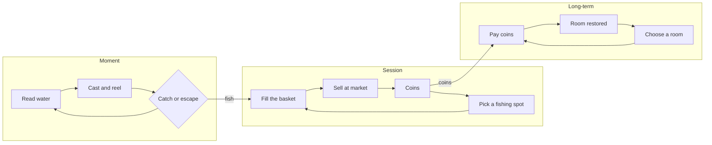

# Worked example: *Tidewright* loop review

Synthetic concept and numbers. **Pitch:** a relaxed fishing game. The player catches fish, sells them, and restores rooms of an old lighthouse. **Audience:** adults playing 20–30 minute evening sessions. **Intended experience:** calm competence and a sense of restoring a place.

## 1–3. Loops

| Loop | Timescale | Goal | Action | Feedback | Reward / carried state | Feeds | Motivation hypothesis | Evidence |
|---|---|---|---|---|---|---|---|---|
| Catch | 10–90 s | land this fish | read ripples, cast, reel against tension | line tension, splash, fish reveal | a fish | session basket | competence | design intent |
| Sell | 20–30 min | earn enough for the next room | choose spot, fill basket, sell | coin count | coins | long-term | progress | design intent |
| Restore | days | restore the lighthouse | pay for a room | room cutscene | restored room | nothing | restoring a place | design intent |

## 4. Arcs

The keeper's letters (one per restored room) and the final lamp lighting. Letters add context to restoration but do not change fishing.

## 5. MDA chain for the main loop

Mechanic: fish species differ in price and catch time. → Predicted dynamic: players fish whatever earns the most coins per minute. → Predicted experience: optimisation, not calm reading of water. This contradicts the brief; the chain shows where.

## 6–7. Diagnosis

**Finding 1: one spot dominates (calculation).**

| Species | Price | Catch + travel time | Coins per minute |
|---|---|---|---|
| Shore minnow | 5 | 20 s | 15 |
| Reef eel | 40 | 90 s | 26.7 |
| Harbour crab | 12 | 30 s | 24 |

Once the reef is unlocked, eels give the most coins per minute and nothing else in the loop rewards variety. Rival explanation: players might fish for variety anyway because the journal shows uncaught species. That is a prediction to check, not a reason to ignore the arithmetic.

**Finding 2: the long-term loop feeds nothing back (rule trace).** Restored rooms change no fishing rule. After the last room, the session loop has no destination: coins accumulate with nothing to buy. Rival: some players may keep fishing for its own sake, which suits a calm game. The concern is the lack of a goal for players who want one, not that everyone must have one.

**Finding 3: the catch loop is the strongest part.** Reading ripples and managing tension is a real decision each cast. Preserve it.

## 8. Levers

| Break | Lever | Cost |
|---|---|---|
| Eels dominate | make value depend on variety: the market pays a premium for species not sold today, or recipes need mixed catches | adds a rule to explain; may push players toward a checklist |
| Rooms feed nothing | each room changes fishing: the lamp reveals night schools; the workshop crafts lures that change which fish bite | more content; each room needs a fishing purpose |
| Post-completion emptiness | keep an open loop: a journal of rare catches tied to weather and time | collection can feel like chores for some players |

**Recommendation:** pair "rooms change fishing" with the journal. It repairs the disconnected loop and gives coins a destination without pressure. Defer the market premium: it fixes dominance but risks turning calm fishing into optimisation, the problem it was meant to solve.

**Smallest check:** a paper or spreadsheet model of three sessions with and without room effects, then a short playtest asking what players wanted to do next at the end of each session. Do not ask whether it felt calm; observe what they choose and ask why.
