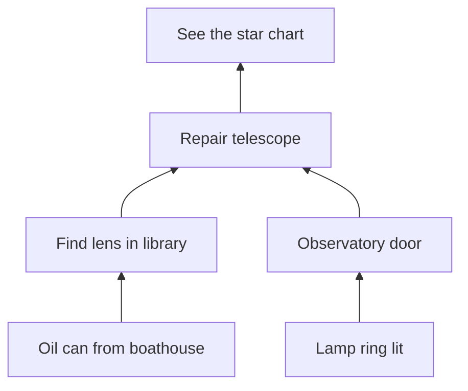

# Worked example: the lamp ring

Synthetic puzzle for an exploration game. **Intended experience:** a quiet "aha" from noticing structure, not a test of patience.

## Version 1

Four lamps in a row, three levers. Each lever flips two neighbouring lamps: A flips lamps 1–2, B flips 2–3, C flips 3–4. All lamps start dark; the goal is all lit.

**Solvability.** Order does not matter (each lever just flips), and pulling a lever twice undoes it, so there are only 2³ = 8 distinct outcomes. Enumerating them: only A + C lights all four. Unique solution.

**Search space problem.** Eight outcomes means a player can find the answer by pulling levers at random in well under a minute, faster than reasoning. The puzzle teaches trial and error. It is fine as an *introduction* to "levers flip neighbours" but has no inference.

## Version 2: the designer's expansion (broken)

The designer arranges five lamps in a ring with five levers (A: 1–2, B: 2–3, C: 3–4, D: 4–5, E: 5–1), starting with lamps 1 and 3 lit, goal all five lit.

**It is impossible.** Every lever flips exactly two lamps, so the number of lit lamps changes by −2, 0, or +2: its parity never changes. It starts at 2 (even); the goal, 5, is odd. No sequence works. Enumerating all 32 outcomes confirms none reaches the goal. A playtest could only show that nobody solved it, which would not say why; the invariant does.

This is the most common way to break a puzzle: a reasonable-looking change to the start state.

## Version 3: repaired

Same ring, start with only lamp 1 lit. Parity now goes from 1 (odd) to 5 (odd), so it is possible. Enumerating the 32 outcomes gives exactly two solutions: **B + D** and **A + C + E**. They are complements (pulling all five levers flips every lamp twice and changes nothing), so finding one implies the other. Both are welcome.

**Key inference:** "each lever flips the pair it stands between, so lamp 1 is already right; I need to flip 2–3 and 4–5 as pairs." The evidence: levers stand physically between the lamps they control, and a pull visibly flips exactly those two.

**Search space.** 32 outcomes is still searchable by brute force, but much slower than reasoning. To reward reasoning further, make the evidence clearer rather than punishing attempts: a lever's two lamps glow faintly while a hand is on it.

**Soft-lock check.** No state is unrecoverable: any outcome can be undone by re-pulling. No reset needed.

## Rules table

| Rule | Status | Evidence |
|---|---|---|
| A lever flips the lamps either side of it | discovered here (taught by Version 1, earlier) | lever position between lamps; both flip on pull |
| Pulling twice undoes | discovered here | pull again, lamps return |
| Order doesn't matter | never needed | — |
| Parity | never needed by the player; used by the designer to prove solvability | — |

## Hint ladder

1. "All the lamps should burn together." (goal)
2. "Watch which lamps change when you pull a lever." (where to look)
3. "Lamp 1 is already lit. Which levers leave it alone?" (relationship)
4. "Pull the lever between 2 and 3, then the one between 4 and 5." (step)

Hints come from a caretaker character, only when asked. Using them changes nothing else.

## Dependency chart (the wing containing the ring)

Two threads are open from the start (ring; boathouse → library), so a stuck player has somewhere else to go. The telescope is a bottleneck by design: it is the payoff.

## Observations

| Question | Observation |
|---|---|
| Is the lever–lamp relation noticed? | Do players look at the lamps while pulling, or only at the lever? |
| Trial and error or reasoning? | number of pulls before solving; ask "how did you know?" afterwards |
| Is the caretaker hint ladder too steep? | which rung players stop at |
